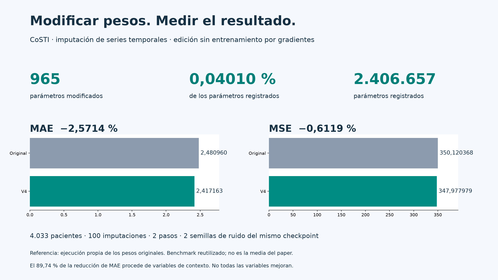
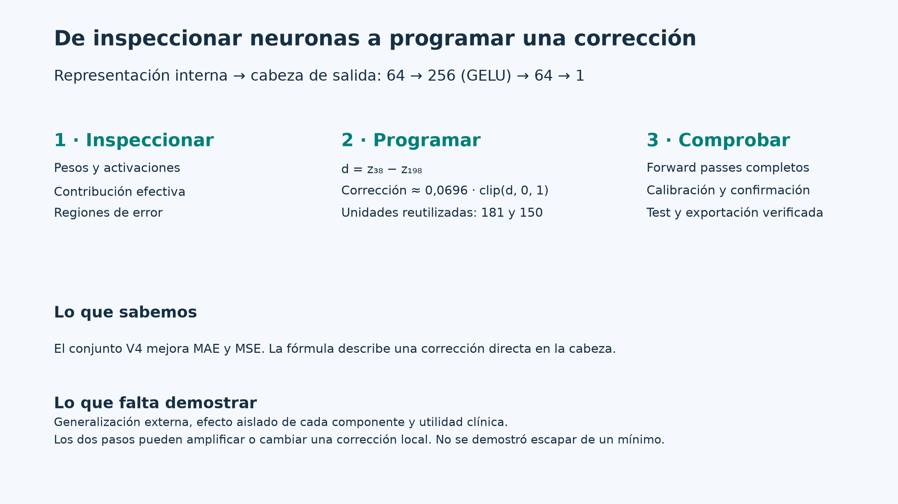

# Editar CoSTI sin entrenarlo: un estudio con un agente de IA

**965 parámetros modificados · 0,04010 % de 2.406.657 parámetros registrados · MAE −2,5714 % · MSE −0,6119 %.**

Estudio de un checkpoint de CoSTI para imputación de series temporales, realizado por un agente Codex bajo la dirección de Javier Solís García. Se inspeccionaron pesos y activaciones, se programaron correcciones explícitas y se evaluaron mediante forward passes. No se usó entrenamiento por gradientes en esta investigación.

| Métrica | Original ejecutado localmente | V4 | Reducción |
|---|---:|---:|---:|
| MAE | 2,480960 | 2,417163 | 2,5714 % |
| MSE | 350,120368 | 347,977979 | 0,6119 % |

PhysioNet Challenge 2019, point missing, version_0; 4.033 pacientes, 100 imputaciones, dos pasos de inferencia y dos semillas de ruido del mismo checkpoint. La referencia es nuestra ejecución de los pesos originales, no la media del paper. El benchmark fue reutilizado durante el estudio.

## Qué problema resolvemos

Una serie temporal registra variables a lo largo del tiempo. En datos hospitalarios faltan mediciones: imputar consiste en estimar esos huecos usando las observaciones disponibles y sus relaciones temporales y entre variables. Aquí se evalúa ocultando valores conocidos mediante point missing; no podemos calcular el error de valores cuya verdad nunca se observó.

Un modelo de consistencia aprende a producir salidas compatibles desde versiones con diferentes niveles de ruido. Esta propiedad permite generar imputaciones en pocos pasos. En nuestro protocolo se generan 100 muestras y se toma su mediana, con dos pasos por muestra. El entrenamiento original del modelo existe; lo que no se entrenó por gradientes fue nuestra edición de pesos.

## Qué hizo el agente

El agente inspeccionó el modelo, descompuso algebraicamente su cabeza de salida, examinó activaciones y errores, escribió ediciones de pesos y ejecutó evaluaciones emparejadas. Javier fijó el objetivo, autorizó la GPU, exigió mejorar ambas métricas y decidió el cierre. Las correcciones retenidas están en la cabeza de salida, incluidas sus neuronas ocultas: ganancia/sesgo, respuesta de las unidades 198, 38, 47 y 255 y un contraste explícito entre 38 y 198. Se reutilizaron unidades con contribuciones pequeñas para calcular funciones concretas.

Las intervenciones más profundas en memoria, atención y grafo no dieron una mejora conjunta verificada. Muchos candidatos se descartaron. Este repositorio documenta un caso concreto; no demuestra que un agente mejore cualquier red ni que se haya escapado de un mínimo local.

## Cómo interpretar las cifras

- El recuento directo da **2.406.657 parámetros registrados**, más 40 valores de buffers en el state_dict. El grafo tiene además 800 valores no registrados. El porcentaje 0,04010 % usa exclusivamente los parámetros registrados como denominador. Véase [recuento](evidence/parameter_counts.json).
- Cambiar pocos parámetros no significa que cada cambio tenga pequeña magnitud ni que el coste de evaluación sea despreciable.
- El 89,74 % de la reducción total de MAE procede de variables demográficas, administrativas y temporales. En fisiológicas, MAE baja 0,288 % y MSE 0,474 %. Las fisiológicas aportan el 76,55 % de la reducción total de MSE.
- 17 de 40 variables mejoran en ambas métricas; el resultado agregado no implica mejora universal ni utilidad clínica demostrada.
- Hay calibración y confirmación separadas, pero el test se reutilizó entre candidatos. Haría falta evaluación externa para reforzar la generalización.
- Dos semillas de ruido de un checkpoint no equivalen a varios entrenamientos independientes.

## Material para explorar y compartir

- [Análisis completo](artifact/analisis_final_v4.txt), [resultados verificados](artifact/resultados_v4.txt).
- [Evolución en PNG](artifact/evolucion_final.png), [PDF](artifact/evolucion_final.pdf) y [HTML interactivo descargable](artifact/evolucion_final.html).
- [Última calibración exploratoria](artifact/calibracion_exploratoria_512.pdf): sus mejoras no se suman al resultado de test.
- [Borrador de hilo para Twitter/X](docs/twitter.txt).
- [Transcripción pública disponible](docs/transcripcion_publica.txt), con alcance y redacciones explicados al inicio.
- [Datos agregados](artifact/datos/) y [evidencia](evidence/).

## Reproducción y procedencia

Código original: [javiersgjavi/CoSTI](https://github.com/javiersgjavi/CoSTI), revisión 362192650eef40aea3dea45c9e1d5fe1b920db2f. Se conserva su licencia MIT y su [README](UPSTREAM_README.md). Enfoque inspirado en [Weight Space Programming](https://rikiyat.github.io/blog/weight-space-programming/).

`src/`, `config/` y `docker/` conservan la base del modelo. `weight_space/` contiene el código de inspección, inferencia, construcción, evaluación y recetas de los experimentos. La receta final es `weight_space/edits/clinical_v0_relative_tail.json`. Los scripts conservan rutas históricas del espacio de trabajo; hay que adaptar las rutas y aportar los datos y el checkpoint originales. No es una reproducción autónoma de un solo comando ni un registro completo de todos los archivos locales.

Los datos individuales, activaciones, predicciones por paciente y checkpoints no se distribuyen en este repositorio. Las recetas y métricas agregadas permiten inspeccionar las modificaciones y resultados. Los informes conservan hashes para enlazarlos con los originales locales. Para ejecutar la evaluación, consultar `python -m weight_space.run --help` en el entorno de dependencias del proyecto. Los scripts de entrenamiento originales se conservan como parte del código upstream, aunque no se ejecutaron en este estudio.

El trabajo experimental está pausado. V4 es la versión completamente verificada; V9/V14 siguen siendo resultados parciales según el informe. No se ha continuado entrenando con SGD ni publicado nada en redes sociales.
