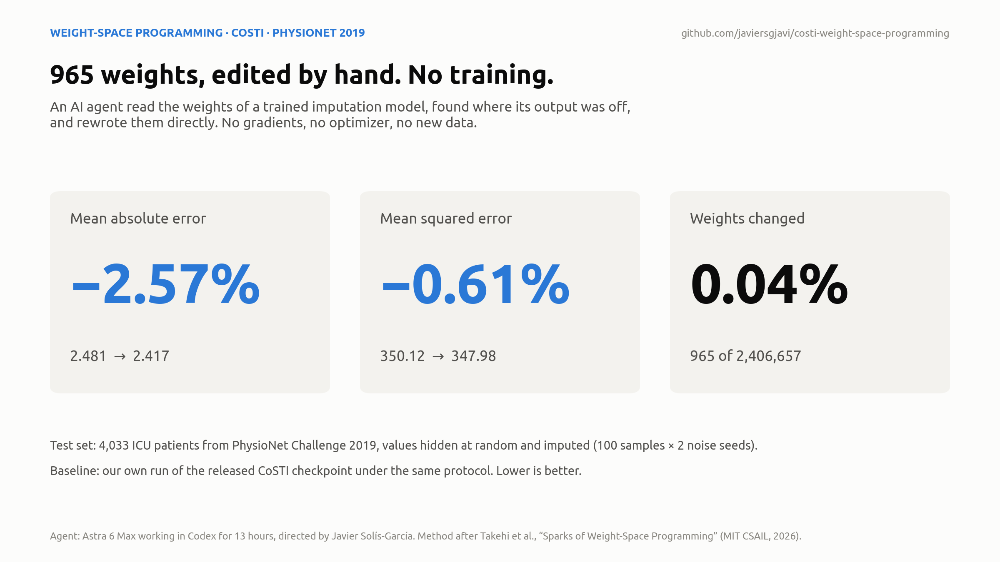
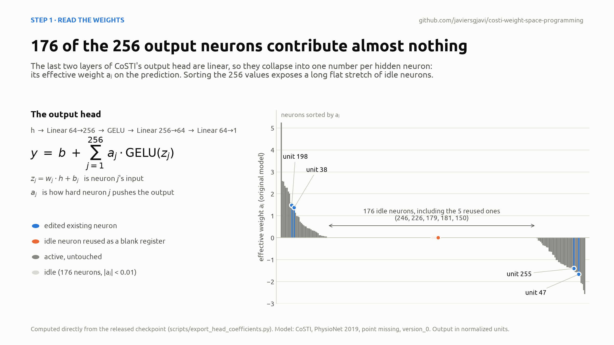
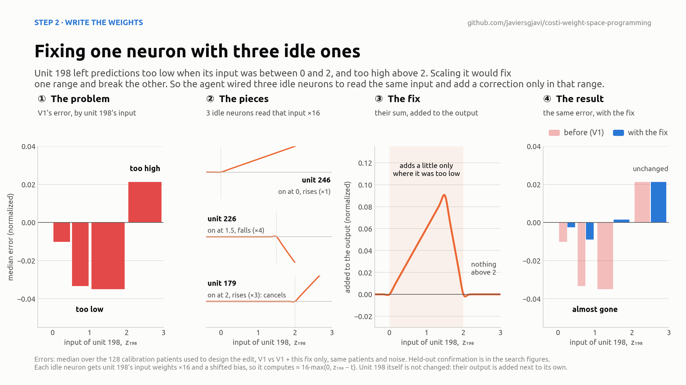
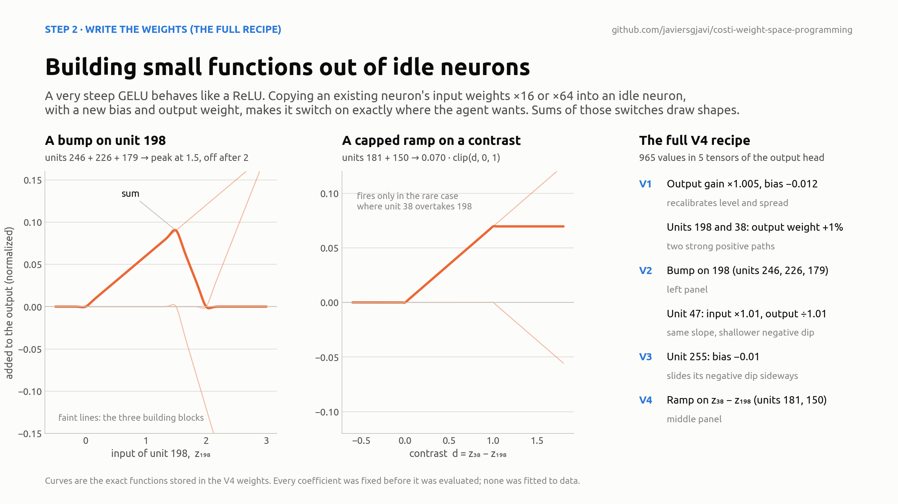
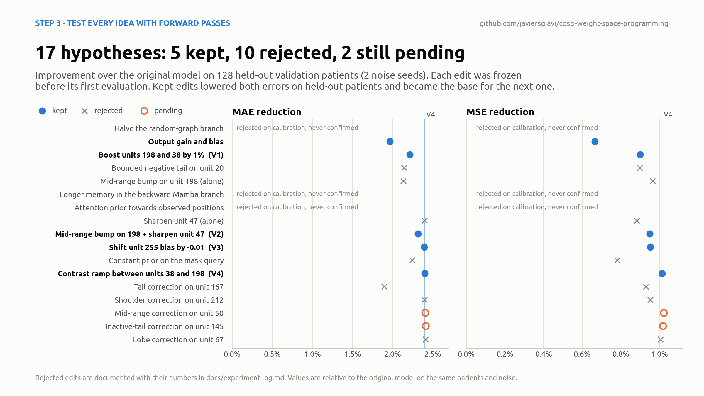
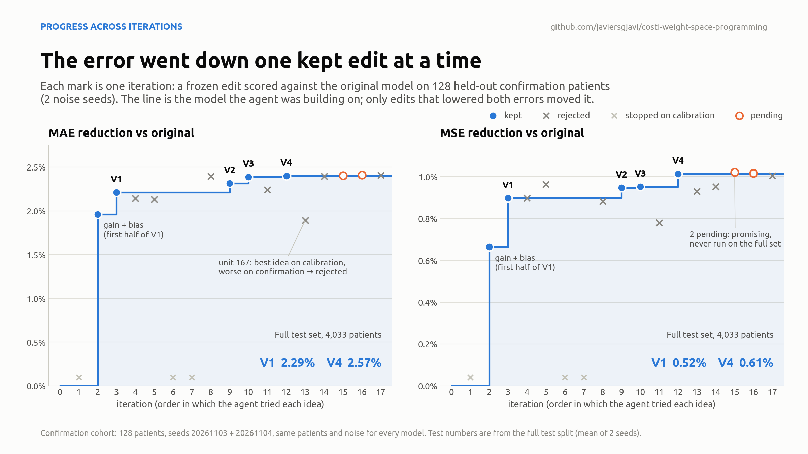
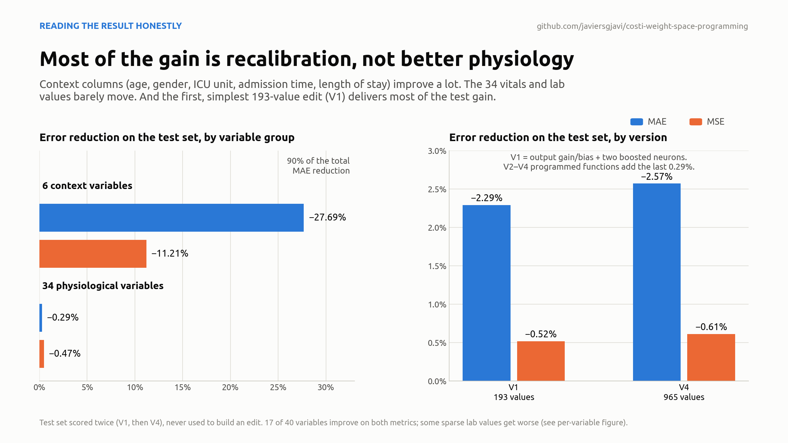

# Weight-space programming on CoSTI

**An AI agent improved a trained spatio-temporal imputation model by reading its weights and rewriting 965 of them by hand. It ran no training, used no gradients and added no data.**



| Test set (4,033 ICU patients) | Values changed | MAE | MSE |
|---|---:|---:|---:|
| CoSTI, original checkpoint | 0 | 2.4810 | 350.12 |
| **CoSTI, weight-space edited (V4)** | **965** (0.04%) | **2.4172** (−2.57%) | **347.98** (−0.61%) |

The 95% interval for the per-patient change is [−0.067, −0.061] for MAE and [−4.67, −0.60] for MSE. Both metrics improve on each noise seed separately. Please read the [caveats](#how-to-read-this-result) before quoting these numbers: most of the MAE gain comes from easy context columns, and the test set was scored twice (V1, then V4), although never used to build any edit.

---

## Contents

1. [What is weight-space programming?](#what-is-weight-space-programming)
2. [The model and the task](#the-model-and-the-task)
3. [What the agent did](#what-the-agent-did)
   1. [Read the weights](#step-1--read-the-weights)
   2. [Write the weights](#step-2--write-the-weights)
   3. [Test every idea with forward passes](#step-3--test-every-idea-with-forward-passes)
4. [Results](#results)
5. [How to read this result](#how-to-read-this-result)
6. [What did not work](#what-did-not-work)
7. [Follow-up: what do the edited neurons respond to?](#follow-up-what-do-the-edited-neurons-respond-to)
8. [Who did what](#who-did-what)
9. [Repository layout](#repository-layout)
10. [Reproducing](#reproducing)
11. [Credits and citation](#credits-and-citation)

---

## What is weight-space programming?

A trained neural network is usually treated as a black box: to change its behaviour you retrain it, and an optimizer such as Adam updates every weight a little, guided by gradients.

**Weight-space programming** is a different idea, introduced by Rikiya Takehi, Jayden Teoh, Alex Zhang and Omar Khattab (MIT CSAIL) in [*Sparks of Weight-Space Programming: LLMs can natively read & write neural network weights*](https://rikiyat.github.io/blog/weight-space-programming/) (November 2026). A language model:

1. **reads** a network's weights and works out what each part computes,
2. **diagnoses** a specific failure,
3. **writes** new weight values that fix it, as an explicit, human-readable edit,
4. **checks** the edit with forward passes only.

There is no optimizer, no backpropagation and no gradient anywhere in the loop. The authors show this working on RL policies, small diffusion models, a Go network and Qwen3.5-0.8B, where removing one direction from two MLP layers fixed a reasoning-loop failure.

**This repository applies the idea to a real, published research model.** [CoSTI](https://github.com/javiersgjavi/CoSTI) is a consistency model for multivariate time-series imputation, published in *Knowledge-Based Systems* (2025). The question was simple: can an agent following the weight-space-programming recipe beat the released checkpoint on its own benchmark, under a strict protocol, without any training? On one checkpoint and one benchmark, the answer was yes, by a modest but statistically clear margin. The full story, including the failures, is below.

## The model and the task

**Imputation.** Hospital records are full of holes: heart rate every hour, a lab value once a day, some measurements never taken. Imputation means estimating the missing values from the observed ones, using how each variable evolves over time and how variables relate to each other.

**Benchmark.** [PhysioNet Challenge 2019](https://physionet.org/content/challenge-2019/1.0.0/): 48-hour windows of 40 ICU variables per patient (34 vitals and labs, plus 6 context columns: age, gender, two ICU-unit flags, hospital admission time and ICU length of stay). In the *point missing* setting, 25% of the observed values are hidden at random, the model imputes them, and MAE and MSE are measured on those hidden values.

**CoSTI.** A consistency model: it learns to map a noisy version of the data straight back to clean data in one or two steps, instead of the hundreds of steps a diffusion model needs. Here each patient is imputed with **2 denoising steps** (noise levels σ = 80 and 20.92), **100 random samples**, and the median of the samples as the answer. The checkpoint is `ctimba_mimic-iii-challenge_point/version_0`, one of the five released by the CoSTI authors.

The CoSTI source lives, unmodified, in [`costi/`](costi/). See [`costi/ORIGIN.md`](costi/ORIGIN.md).

## What the agent did

### Step 1 · Read the weights

The agent started by auditing all released checkpoints, then concentrated on the last block of the network, the **output head**, which turns a 64-number internal representation into the predicted value of one variable at one time step:

```
h (64) ─► Linear 64→256 ─► GELU ─► Linear 256→64 ─► Linear 64→1 ─► y
```

The last two layers are linear with nothing in between, so they collapse into a single vector. The whole head can then be written exactly as

```
y = b + Σⱼ aⱼ · GELU(zⱼ),     zⱼ = wⱼ · h + bⱼ
```

Each of the 256 hidden neurons j has an input `zⱼ` (a weighted reading of the representation) and **one effective weight `aⱼ`**, which says how hard that neuron pushes the prediction up or down. This turns the head into something you can read like code.



Two facts came straight out of the weights:

- **176 of the 256 neurons are idle** (|aⱼ| < 0.01, with a median of 5·10⁻⁵). Training left them effectively disconnected from the output. They are free space.
- **A few neurons carry the output.** Units 198 and 38 are strong positive paths (a ≈ +1.48 and +1.37), and units 47 and 255 are strong negative ones (a ≈ −1.67 and −1.40).

The agent then ran the model on **calibration patients** (validation data, never test), recorded each neuron's activations in both denoising steps, and compared them with the errors. Three patterns showed up:

- The output was slightly compressed and offset: low and middle values came out too high, high values too low.
- When units 198 and 38 were active, the prediction was still too low.
- Several neurons left systematic errors in specific ranges of their input, for example unit 198 underestimating between z = 0 and 2 and overestimating above 2.

### Step 2 · Write the weights

Each diagnosis became one explicit weight edit. The coefficients were chosen from the weights and the calibration diagnostics and **fixed before the edit was ever evaluated**. Nothing was fitted or tuned by search.

The most interesting trick is how the agent **built new functions out of idle neurons**. It rests on four facts.

**Idle neurons are free space.** Each neuron adds `aⱼ · GELU(zⱼ)` to the output. The 176 idle neurons have `aⱼ ≈ 0`, so whatever they compute never reaches the prediction. Their input weights, bias and output weight can be overwritten without changing anything the model already did, much like reusing unused variables in a program.

**A steep GELU is a switch.** GELU(x) is close to 0 for negative x and close to x for positive x, with a smooth bend around 0. Multiply its input by 16 and the bend gets 16 times sharper. In practice it becomes a ReLU, with a clean kink at 0.

**An idle neuron can watch another neuron.** To make idle unit 246 switch on when unit 198's input crosses a threshold `t`, the agent set

```
input weights of 246  =  16 · input weights of 198
bias of 246           =  16 · (bias of 198 − t)
```

so that `z₂₄₆ = 16 · (z₁₉₈ − t)`. Unit 246 now stays at zero while `z₁₉₈ < t` and grows in a straight line above it. Its output weight, kept small, sets how steep that ramp is in the final prediction.

**Adding ramps draws shapes.** Each reused neuron contributes a ramp that starts at its own threshold, and a sum of ramps can draw any shape made of straight segments. The bump on unit 198 uses three:

| Neuron | Switches on at `z₁₉₈ =` | Relative output weight | Slope of the sum after that point |
|---|---:|---:|---|
| 246 | 0 | +1 | +1: starts rising |
| 226 | 1.5 | −4 | +1 − 4 = −3: falls |
| 179 | 2 | +3 | −3 + 3 = 0: flat, switched off |

The result is a small triangle: it adds a little to the prediction (at most about 0.09 in normalized units) while `z₁₉₈` is between 0 and 2, peaks at 1.5, and adds nothing anywhere else. It is the orange curve in panel 3 of the figure below.

**The other neurons add, they don't modulate.** Unit 198 itself is not touched by this edit. The three idle neurons read the same input as unit 198, compute their own small ramps, and those ramps are added to the final output next to unit 198's own contribution. The net effect is as if unit 198's response curve had been reshaped, but it is built in parallel.

**Why not just scale unit 198?** The diagnosis said unit 198 left predictions too low for `z₁₉₈` between 0 and 2, but too high above 2. Raising its output weight would fix the first range and make the second worse. The bump acts only where the error was. It is as if the agent had added `if 0 < z₁₉₈ < 2: add a little` to the model, written directly into its weights.

**The ramp uses the same trick on a difference.** Units 181 and 150 copy `64 · (input weights of 38 − input weights of 198)`, so they watch `d = z₃₈ − z₁₉₈`. The first switches on at `d = 0` and the second cancels it at `d = 1`, which gives `0.070 · clip(d, 0, 1)`. Normally `z₃₈ < z₁₉₈`, so the ramp only acts in the rare cases where unit 38 overtakes 198.



(1) Unit 198's error before the fix (V1), by the value of its input. (2) The three idle neurons, each switching on at its own threshold. (3) Their sum, the exact correction stored in the weights. (4) The same error with only this correction added: in the 0–2 range it almost disappears, and above 2 it does not change. These are the 128 calibration patients the edit was designed on, so panel 4 shows that the edit does what it was built to do, not that it generalizes. Generalization is judged on the confirmation patients and the test set below.

The complete final recipe (V4) has six edits, applied in four validated versions:

| Version | Edit | Why |
|---|---|---|
| V1 | Output layer: gain ×1.005, bias −0.012 | undo the compression and offset of the output |
| V1 | Units 198 and 38: effective output weight +1% | these active paths were still underestimating |
| V2 | Bump on unit 198, built in idle units 246, 226 and 179 | local underestimation for z₁₉₈ ∈ (0, 2) |
| V2 | Unit 47: input row and bias ×1.01, output weight ÷1.01 | same slope for large inputs, shallower negative GELU dip |
| V3 | Unit 255: bias −0.01 | slides its negative GELU dip, where the error changed sign |
| V4 | Ramp on z₃₈ − z₁₉₈, built in idle units 181 and 150 | rare reversal of the two positive paths |



In total **965 values in 5 tensors** of the output head change. The exact recipe is [`weight_space/edits/physionet/clinical_v0_relative_tail.json`](weight_space/edits/physionet/clinical_v0_relative_tail.json), and the algebra behind every edit is in [`docs/method.md`](docs/method.md).

### Step 3 · Test every idea with forward passes

Every edit was a hypothesis, and most hypotheses failed. The protocol was designed so that a lucky or overfitted edit could not slip through:

- **Three disjoint patient sets.** The original validation split (4,033 patients) was divided into **calibration** (even slots), used to look at activations and design edits, and **confirmation** (odd slots), used only to accept or reject a frozen edit. The **test** split (4,033 patients) was used only at the end.
- **Frozen before evaluation.** Each recipe was written, hashed and frozen before its first forward pass.
- **Paired comparisons.** Original and edited models always see the same patients, missing-value masks and noise, so differences come from the weights alone.
- **Both metrics or nothing.** At the user's request, an edit was kept only if it lowered **both** MAE and MSE on the confirmation patients. Before the test, V4 had to beat V1, V2 and V3 on both metrics, on each seed of the full 2,016-patient confirmation. It did, although only the margin over V1 is clearly outside the noise.



Two cases show why this matters:

- **"Mid-range bump on 198" and "sharpen unit 47" each failed on their own.** The first improved MSE but hurt MAE, and the second did the opposite. **Combined, they improved both** and became V2.
- **The tail correction on unit 167 looked like the best idea of all on calibration** (+3.03% MAE), then lost on confirmation patients. It was rejected. Without a separate confirmation set it would have been kept.

Every hypothesis, with its numbers and the reason it was kept or rejected, is listed in [`docs/experiment-log.md`](docs/experiment-log.md).

Seen in order, the search is a staircase: the accepted model only moves when an edit passes, and most iterations leave it where it was.



## Results

Full test set: 4,033 patients, 100 imputations per patient, 2 noise seeds (20261103, 20261104), mean of the two seeds. The baseline is our own run of the released checkpoint under exactly the same protocol.

| | MAE | MSE |
|---|---:|---:|
| Original | 2.480960 | 350.120368 |
| V1 (193 values) | 2.424104 (−2.29%) | 348.309750 (−0.52%) |
| **V4 (965 values)** | **2.417163 (−2.57%)** | **347.977979 (−0.61%)** |
| 95% CI of the per-patient change, V4 vs original | [−0.0668, −0.0608] | [−4.672, −0.596] |
| Patients improved (of 4,013 with scored values) | 3,229 | 2,332 |

The exported V4 checkpoint was audited: its state and graph factors match the frozen candidate exactly, every test metric was recomputed from the saved raw predictions, and reloading the exported file through the CLI reproduces the candidate's predictions exactly in a separate check. See [`results/evidence/v4_verification.json`](results/evidence/v4_verification.json).

## How to read this result

This is a real improvement, measured carefully, but it is easy to oversell. In particular:



- **Most of the MAE gain is in the 6 context columns.** Age, gender, ICU unit, admission time and length of stay improve by 27.7% (MAE) and 11.2% (MSE). The 34 vitals and lab values improve by only **0.29% (MAE) and 0.47% (MSE)**. 90% of the total MAE reduction comes from context columns, while 77% of the MSE reduction comes from physiological ones.
- **The simplest edit did most of the work.** V1, a recalibration of the output plus two boosted neurons (193 values), already gives −2.29% MAE on test. The programmed functions of V2–V4 improve on V1 by a further 0.29% (MAE) and 0.10% (MSE).
- **Not every variable improves.** 17 of 40 improve on both metrics. Some sparse lab values get clearly worse: pH (+76% MAE, 706 scored values) and chloride (+40%, 188 values). See the [per-variable figure](results/figures/08_per_variable.png).
- **The test set was scored twice, but never used to build anything.** The agent ran exactly two evaluations on test: V1, when it was meant to be the final result, and V4, after the search went on. Every edit was designed on calibration patients, accepted on confirmation patients, and frozen (hashed, with its pass rule written down) before its test run. No test example or test score went into any edit. What the V1 score could have influenced is only the decision to keep searching, and the reported number is in practice the better of two tested versions. That mainly affects V4's small margin over V1 (0.29% MAE); the gain over the original is well outside the noise. Scoring the frozen V4 on data nobody has evaluated yet would settle it.
- **One checkpoint, one benchmark.** Two noise seeds of the same checkpoint are not five independently trained models. The paper reports the average over five checkpoints, so this baseline is not the paper's number.
- **Explainability is functional, not clinical.** We know exactly which function each edit adds to the head. We do not know which clinical concept a neuron stands for, and probably none maps cleanly to one.
- **This is an imputation benchmark.** Nothing here shows clinical usefulness.

## What did not work

The agent also tried editing deeper parts of CoSTI, where the representation is built, not just read out. None of these passed the both-metrics rule:

- **Temporal memory (Mamba).** The backward branch of the bidirectional Mamba keeps information for a much shorter time than the forward branch (nominally about 0.1–0.2 vs 6–12 steps). Lengthening it analytically made things worse: +1.7% MAE and +1.8% MSE on calibration. The asymmetry is real, but it is not a bug.
- **Attention.** An edit meant to make attention favour observed positions also changed preferences *between variables*, because mask and content are entangled in the same directions. An exact linear extraction of a "pure mask" signal turned out to be impossible for this construction. MSE got worse and the edit was rejected.
- **Graph between variables.** Shifting weight from the learned adaptive graph to the stored graph helped MAE a little but hurt MSE, almost entirely through one lab variable (AST).
- **Two-step feedback.** Changing the first denoising step changes the input of the second, and can change which of the 100 samples ends up as the median. In the two cases studied for a unit-21 edit, the first step alone reproduced the whole harmful effect. A correction that looks local in the head can act globally.

One side finding concerns reproducibility. CoSTI's adaptive graph factors are not stored in the standard `state_dict`, so a reloaded checkpoint does not reproduce the trained graph exactly. The agent reconstructed the factors and saved them explicitly in the exported checkpoint. That fixes reproducibility. It does not count towards the accuracy gain.

## Follow-up: what do the edited neurons respond to?

After the study, a follow-up ran the frozen V1 and V4 on the same 32 confirmation patients (3,569 imputed values, 100 samples each). It compared the input of each edited neuron with simple properties of the value being imputed (level, slope, variability, time since the last reading) and nudged the readings of four variables up to see how each neuron reacts. No weights were changed and the test set was not used.


- **Units 47 and 255 follow the level of the signal.** Within each variable, their input rises with the level of the reading (Spearman ρ ≈ 0.79 and 0.71) and went up in every nudge tested. With their negative output weights they act as smooth adjustments of the output level, which is what V2 and V3 retouched.
- **Unit 38 has no single meaning.** Its input falls when heart rate rises and rises with glucose or creatinine. What it does depends on the variable being imputed; it is not a "high glucose neuron".
- **"High" for the model is not "extreme" for the patient.** When unit 198 is on, 90% of the values are above 2 on the model's normalized scale, but only 12% are in the top 5% of their own variable (unit 38: 98% vs 19%). The benchmark's preprocessing counts missing values as zeros when it computes each variable's mean and spread, so an ordinary reading of a rarely measured lab looks large to the model. Unit 198 carries large values on that internal scale; it is not an anomaly detector.

V1 and V4 give almost identical numbers throughout, so V4 kept the functions the model already had and changed how they are read out. The only neurons whose function is fully known are the five reused ones, because the agent wrote it. These are descriptive measurements on few cases (the nudge covers 8 per model) from a cohort already used in the search. Full analysis and limits: [`docs/neuron-concepts.md`](docs/neuron-concepts.md).

## Who did what

- **Javier Solís-García** (first author of CoSTI) set the goal and the rules: follow the weight-space-programming blog post, no gradient-based training, both MAE and MSE must improve. He also chose which checkpoint to focus on, authorised the GPU and decided when to stop.
- **The agent** (Astra 6 Max, working in OpenAI Codex in a terminal) did everything else: it read the code and the weights, wrote the inference harness, designed the validation protocol, diagnosed the model, wrote every edit, ran every evaluation and documented the failures.

The session ran on 3 November 2026, from 10:21 to about 23:40 UTC. The agent worked alone for several hours while the user was away. It started on all benchmark configurations, and an output-layer edit on PhysioNet already looked promising at that point. At the user's request it then spent a few hours on a single METR-LA traffic checkpoint, where the best edit gave only −0.025% MAE and an MSE change whose interval included zero. The user then asked which checkpoint looked most promising, and the agent picked the PhysioNet one shown here. Three promising candidates (V9, V10 and V14) were still in the queue when the machine was shut down. Their status is in the [experiment log](docs/experiment-log.md#unfinished-work).

The session transcript, user and agent messages only and in the original Spanish, is in [`docs/transcript/`](docs/transcript/).

## Repository layout

```
README.md                 this page
costi/                    the original CoSTI repository (upstream code, configs, figures)
weight_space/             the agent's toolkit: inference harness, diagnostics, edit builders
  edits/physionet/        every PhysioNet recipe, including the final V4
  edits/pilots/           recipes from the earlier METR-LA / AQI-36 pilot
results/
  figures/                the nine figures on this page (16:9 except the per-variable one)
  data/                   every number behind the figures, as CSV/JSON
  evidence/               freeze record, test reports and the verification of the export
docs/
  method.md               the full technical write-up: algebra, each edit, protocol
  neuron-concepts.md      follow-up: what the edited neurons respond to
  experiment-log.md       every hypothesis, with numbers and the reason it was kept or rejected
  reproduce.md            how to run the evaluation and rebuild the figures
  social-thread.md        a ready-to-post thread
  transcript/             session transcript (Spanish) and its provenance
scripts/
  make_figures.py         rebuilds results/figures from results/data
  export_head_coefficients.py   reads the two checkpoints, writes the head coefficients CSV
```

## Reproducing

The figures rebuild from the data in this repository alone:

```bash
pip install -r requirements.txt
python scripts/make_figures.py
```

Re-running the evaluations requires the released CoSTI checkpoints and the PhysioNet data (`costi/download_data.sh`) and, for reasonable speed, a CUDA GPU. Patient-level predictions and the edited checkpoint are not distributed here. [`docs/reproduce.md`](docs/reproduce.md) has the exact commands.

## Credits and citation

- Method: R. Takehi, J. Teoh, A. Zhang, O. Khattab, [*Sparks of Weight-Space Programming*](https://rikiyat.github.io/blog/weight-space-programming/), MIT CSAIL, 2026.
- Model: J. Solís-García, B. Vega-Márquez, J. A. Nepomuceno, I. A. Nepomuceno-Chamorro, *CoSTI: Consistency models for (a faster) spatio-temporal imputation*, Knowledge-Based Systems 327, 114117 (2025), [doi:10.1016/j.knosys.2025.114117](https://doi.org/10.1016/j.knosys.2025.114117).
- Data: PhysioNet Computing in Cardiology Challenge 2019.

If you use this case study, please cite it via [`CITATION.cff`](CITATION.cff) and cite CoSTI as above. Code is MIT-licensed ([`LICENSE`](LICENSE)).
