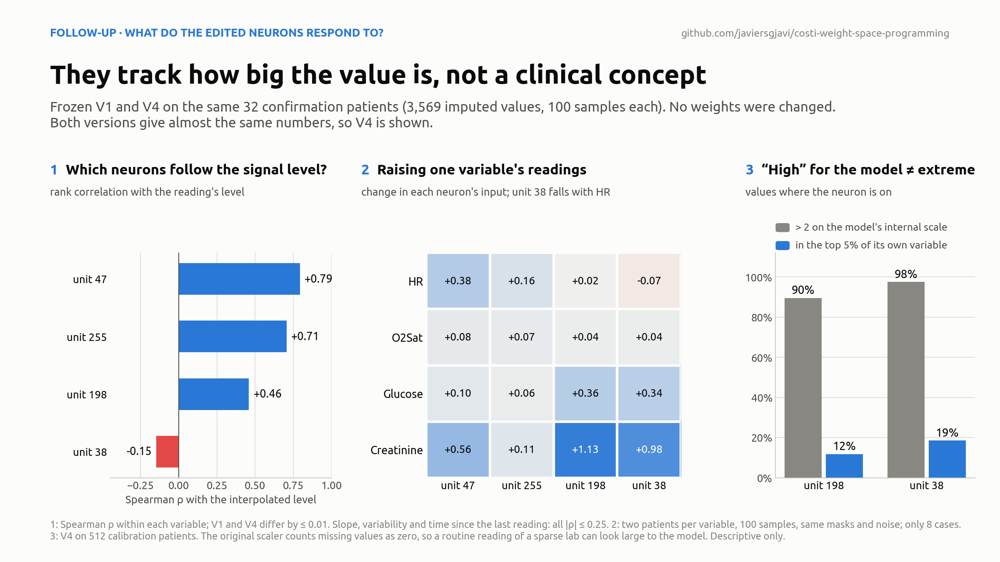

# What do the edited neurons respond to?

A follow-up to the study, run on 5 November 2026. It asks what the output-head neurons touched by the edits respond to. The method is the same as in the study: forward passes only, no training, no fitted probes, no gradients. **No weights were changed and the test set was not used.** This is interpretation, not a new result.

## Short version

| Unit | What it most plausibly does | Why we think so | What we cannot say |
|---|---|---|---|
| 47, 255 | Smooth adjustment of the output level | Their input rises with the level of the reading (ρ ≈ 0.79 and 0.71) and with every input nudge tested | That they stand for any clinical concept |
| 198 | Carries values that are large **on the model's internal scale** | Positive mostly when the normalized value is above 2 | That it detects clinical anomalies: most of those values are ordinary for their variable |
| 38 | A level response that depends on the variable | Falls when HR rises, rises with glucose or creatinine | That it has one meaning, such as "high glucose" |
| 246, 226, 179 | The bump on unit 198 | Written by the agent: known by construction | Anything clinical beyond what unit 198 means |
| 181, 150 | The ramp on z₃₈ − z₁₉₈ | Written by the agent: known by construction | A clinical label: it fires in only a handful of values |

V1 and V4 give almost the same numbers in every measurement, so V4 kept the functions that were already there and only retouched how they are read out. The only neurons whose function is fully known are the five reused ones, because the agent wrote them.

## Data

- **Paired forward passes:** V1 and V4 on the same 32 confirmation patients, with the same masks, noise and seed (20261103): 3,569 scored values, 100 samples each, both denoising steps recorded.
- **Saved activations:** V4 on 512 calibration patients (51,979 scored values), and V1 on 128 calibration patients (12,977 values). These cohorts differ in size, so they are not compared directly.

For each scored value, the analysis computes simple properties of the signal being imputed: its interpolated level, slope, temporal variability, observation density, hours to the nearest real observation, and time in the window.

The analysis also distinguishes three things that are easy to confuse: a neuron's **input** z, its **activation** GELU(z), and its **contribution** a·GELU(z). GELU is not monotonic and a can be negative, so reading the wrong one can flip an interpretation.

## 1. Units 47 and 255 follow the signal level

Within each variable (ranks computed per variable, so that differences in scale between variables do not count), the input of each unit correlates with the level of the reading:

| Unit | V1 | V4 |
|---|---:|---:|
| 47 | 0.792 | 0.792 |
| 255 | 0.697 | 0.706 |
| 198 | 0.460 | 0.459 |
| 38 | −0.156 | −0.147 |

Correlations with slope, variability, observation density, distance to an observation and time are all at most 0.25 in absolute value.

**Input nudge.** Four variables (HR, O2Sat, glucose, creatinine) and two patients per variable were fixed before running the models. The observed readings of that variable were raised by half a standard deviation of its real training observations, keeping the mask, the temporal shape and the noise unchanged. The change in each neuron's input was averaged over all 100 samples, so that a change in which sample becomes the median does not explain the effect. In all 8 cases and in both versions, the inputs of 47 and 255 went up.

Both units have negative output weights. Where their GELU is negative, their contribution to the output is positive. That fits a smooth level adjustment, and it fits how V2 and V3 edited them: unit 47 was made slightly sharper and unit 255's bias was shifted.

## 2. Unit 38 has no single meaning

In the same nudge, unit 38's input **fell when HR rose** (both cases) and **rose when glucose or creatinine rose**. Across variables it is associated with high normalized values, yet within each variable its correlation with the level is slightly negative. Its role depends on which variable is being imputed and on the magnitude regime. It cannot be assigned to glucose, troponin, hypoxia or any single condition.

## 3. "High" for the model is not "extreme" for the patient

This is the most important finding. Among V4's calibration values where a unit's input is positive:

| Unit | Values where it is on | Normalized value > 2 | In the top 5% of its own variable | Median percentile within its variable |
|---|---:|---:|---:|---:|
| 198 | 4,163 | 89.5% | 11.7% | 53 |
| 38 | 1,295 | 97.5% | 18.5% | 73 |

The percentiles use only real training observations of each variable.

The reason is the preprocessing inherited from the CoSTI benchmark. It replaces missing values with zero **before** computing each variable's mean and standard deviation. For a rarely measured lab, most of the zeros are missing values, so the mean is pulled towards zero and an ordinary reading lands far above it on the normalized scale. Unit 198 is therefore a path for values that are large on the model's internal scale, not a clinical anomaly detector. The preprocessing was kept unchanged to stay comparable with CoSTI.

## 4. The reused neurons

Their function is known exactly because the agent wrote it (see [`method.md`](method.md) §3.3 and §3.6):

- **246, 226, 179:** `k·[GELU(16 z₁₉₈) − 4·GELU(16 (z₁₉₈ − 1.5)) + 3·GELU(16 (z₁₉₈ − 2))]/16`, with `k = 0.04·a₁₉₈`. This is a triangular correction between 0 and 2. Its "concept" is *correct this range of unit 198*. Any clinical meaning would come from unit 198, and as shown above, that meaning is weak.
- **181, 150:** `A·[GELU(64 d) − GELU(64 (d − 1))]/64`, with `d = z₃₈ − z₁₉₈` and `A = 0.0696`. It approximates `A·clip(d, 0, 1)`. In V4 it fires in 13 calibration values from 9 patients (10 of them troponin I) and in 5 values from 4 of the 32 confirmation patients (AST, alkaline phosphatase ×2, creatinine, troponin I). The second sample rules out a troponin-only reading. The cases have very high normalized values and sparse observations. A fair description is "a rare regime of very large values in sparse signals", and even that needs more cases.

## 5. How much each unit moves the prediction

Removing a unit's contribution at the last denoising step only, then recomputing the median of the 100 samples, changes V4's prediction on average by 0.203 (unit 198), 0.081 (255), 0.064 (47) and 0.047 (38), in normalized units. These are effect sizes, not MAE changes. A full removal pushes the model into states it never sees, and this check does not include the feedback through the two denoising steps. The implementation of this ablation was checked against a real intervention on unit 47's activation for one patient and 100 samples: the maximum difference was 1.5·10⁻⁵.

## Limits

- The correlations are descriptive. Values within a patient are not independent, and a weak marginal correlation does not rule out a non-linear or context-dependent role.
- The input nudge covers 8 cases per model (2 patients × 4 variables). It shows sensitivity to a mathematical change of the input, not the effect of a clinical intervention.
- The 32 patients come from the confirmation set already used during the search. This is not an external validation.
- Training percentiles are statistical reference points, not clinical normal ranges.

## Files

- Aggregate measurements (no patient identifiers or activation rows): [`results/data/clinical_neuron_concepts_summary_20261105.json`](../results/data/clinical_neuron_concepts_summary_20261105.json)
- Forward plan, ablation check and provenance: `results/evidence/clinical_concepts_*_20261105.json`, `results/evidence/clinical_concept_ablation_verification_20261105.json`
- Analysis scripts, kept as a record: `weight_space/analyze_clinical_neuron_concepts.py`, `diagnose_clinical_concepts_forward.py`, `verify_clinical_concept_ablation.py` and `summarize_clinical_concepts.py`. They need the private activation dumps and data from the original workspace.
- The figure is rebuilt from the JSON alone by `python scripts/make_figures.py`.

Methodological references for the approach, which this analysis does not fully implement: Network Dissection ([Bau et al., 2017](https://arxiv.org/abs/1704.05796)) and causal abstraction ([Geiger et al., 2021](https://arxiv.org/abs/2106.02997)).
